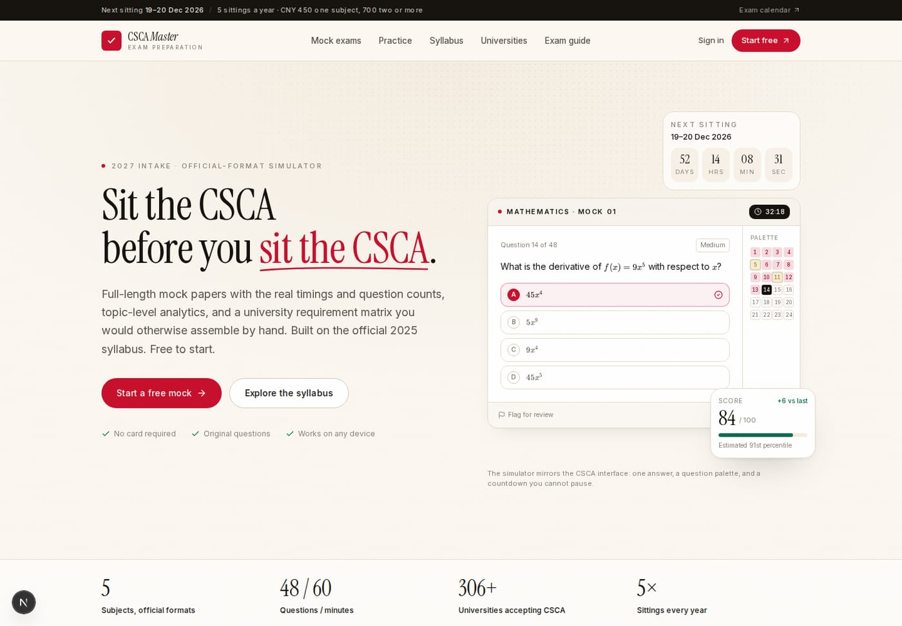
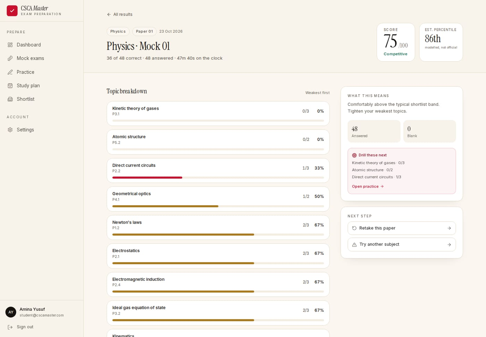
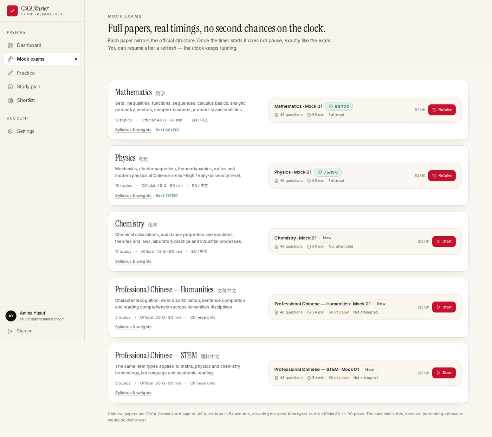

# CSCA Master

**Exam-accurate preparation for the China Scholastic Competency Assessment.**
Production target: **[www.cscamaster.com](https://www.cscamaster.com)** · local: **http://localhost:3002**

CSCA Master is a full preparation platform for international students applying to Chinese
universities. It pairs an exam-fidelity simulator with topic-level analytics, a spaced-review queue, a
bilingual syllabus explorer and a university requirement directory.

The CSCA is administered by the China Scholarship Council. It becomes a required undergraduate
admission document for Chinese Government Scholarship universities in the 2026/27 cycle, and for all
undergraduate applicants from 2028.



| Exam simulator | Result & topic breakdown |
| --- | --- |
|  |  |

| Dashboard | Mock library |
| --- | --- |
|  |  |

---

## Quick start

```bash
npm install
cp .env.example .env.local     # already present in this checkout
npm run db:seed                # subjects, syllabus, 272 questions, 5 papers, 307 universities
npm run dev                    # boots the embedded database, then Next.js
```

Open the URL Next prints — **http://localhost:3002** in this environment, because port 3000 is
already used by another project. To force the canonical port: `npm run dev -- -p 3000`.

There is **no database to install.** `npm run dev` starts a Postgres-compatible engine (PGlite) on
`127.0.0.1:55432`, persists it to `.pglite/`, and points Prisma at it. Every query is real SQL, so
production behaves the same on managed Postgres.

### Demo accounts

| Role | Email | Password |
| --- | --- | --- |
| Student | `student@cscamaster.com` | `password123` |
| Admin | `admin@cscamaster.com` | `password123` |

The student account is seeded with two completed papers so the dashboard has history.

---

## What is built

### Marketing, content & SEO

- `/` — conversion landing page with a live countdown to the next sitting
- `/csca` — long-form exam guide (format, subjects, fees, scoring, exemptions, registration)
- `/exam-dates` — published 2026–27 sittings, timetable in Beijing time, regional suitability
- `/syllabus` + `/syllabus/[subject]` — official topic tree with weights and drill links
- `/universities` + `/universities/[slug]` + `/universities/city/[city]` — 307 institutions
- `/sample-questions` — free sample questions, no account required (top-of-funnel SEO asset)
- `/tools/score-calculator` — score and percentile estimator
- `/glossary` — CSCA terminology, linkable definitions
- `/guides` + five long-form guides (CSCA vs HSK, 8-week plan, subjects by major, registration, scoring)
- `/pricing`, `/about`, `/contact` — waitlist capture, methodology, lead form
- Static-first output, canonical URLs, OpenGraph image, `sitemap.xml`, `robots.txt`, `llms.txt`
- JSON-LD: Organisation, WebSite, Course, FAQPage, Article, BreadcrumbList, DefinedTermSet

### Exam simulator

- Official structure: 48 questions / 60 minutes for Maths, Physics and Chemistry; Chinese papers run
  48 questions / 54 minutes and are labelled as short papers
- Server-anchored timer (a refresh cannot buy minutes), auto-submit at zero
- Question palette, flags, answered/unanswered states, keyboard shortcuts (`1–4`, `←/→`, `F`)
- Autosave every ~1s to the server; resume on any device with the clock still running
- EN/中文 toggle for fundamental subjects
- LaTeX rendered through KaTeX
- Scoring on the server only: raw correct → 0–100, per-topic breakdown, modelled percentile

### Analytics & study

- Dashboard: readiness score, score trend, topic mastery, next sitting countdown, review queue
- Result review: every question, your answer, the correct answer and the working — collapsed by
  default so a 48-question review is navigable
- Practice: 50 topics, 10-question sets, instant explanations, attempt tracking
- Smart review: spaced-repetition ladder (1 → 3 → 6 → 12 → 21 days)
- Study plan: three phases dated backwards from the target sitting, with a persisted checklist

### Admin

- `/admin` — students, submissions, average score, bank coverage
- `/admin/content` — curriculum and paper inventory
- `/admin/leads` — waitlist and contact enquiries

---

## Stack

| Layer | Choice |
| --- | --- |
| Framework | Next.js 16 (App Router, Server Components, Server Actions) |
| UI | React 19, Tailwind CSS v4, Radix primitives, Lucide icons |
| Data | Prisma 7 + PostgreSQL (PGlite locally, managed Postgres in production) |
| Auth | Email + password (bcrypt), JWT in an httpOnly cookie (`jose`) |
| Charts | Recharts for the score trend; CSS for everything else |
| Maths | KaTeX (server-rendered HTML) |

No external auth vendor, no UI kit at runtime, no third-party analytics.

---

## Content pipeline

All curriculum content lives in version-controlled TypeScript, not in an admin form:

```
prisma/seed-data/
  syllabus.ts                      # 5 subjects + 50 topics, bilingual, with weights
  universities.ts                  # curated requirement profiles
  questions/math.ts                # 56 original items
  questions/physics.ts             # 56
  questions/chemistry.ts           # 56
  questions/chinese-humanities.ts  # 52
  questions/chinese-stem.ts        # 52
```

`npm run db:seed` is idempotent: stable IDs mean you can edit a question and re-seed without losing
attempt history. Mock papers are rebuilt from the bank on each seed.

Question shape:

```ts
{
  topic: "M2.4",                 // syllabus topic code, required
  difficulty: "MEDIUM",          // EASY | MEDIUM | HARD
  stem: "Differentiate $f(x)=3x^{4}-2x$.",
  stemZh: "求 $f(x)=3x^{4}-2x$ 的导数。",
  options: ["12x³ − 2", …],      // exactly 4
  optionsZh: ["12x³ − 2", …],
  correct: 0,
  explanation: "Power rule …",
  explanationZh: "由幂函数求导法则 …",
  tags: ["derivatives"]
}
```

---

## Exam reference (verified October 2026)

| Paper | Questions | Time | Language | Score |
| --- | --- | --- | --- | --- |
| Professional Chinese — Humanities | 80 | 90 min | Chinese | 0–100 |
| Professional Chinese — STEM | 80 | 90 min | Chinese | 0–100 |
| Mathematics | 48 | 60 min | Chinese / English | 0–100 |
| Physics | 48 | 60 min | Chinese / English | 0–100 |
| Chemistry | 48 | 60 min | Chinese / English | 0–100 |

Fees: CNY 450 for one subject, CNY 700 for two or more. Five sittings a year (Jan, Mar, Apr, Jun,
Dec). Results within 7 working days for online/computer-based, 14 for paper-based. Registration only
at [csca.cn](https://csca.cn).

---

## Deployment

1. Create a managed Postgres database (Neon, Supabase, RDS).
2. Set environment variables on Vercel:

   ```
   DATABASE_URL=postgresql://…
   JWT_SECRET=<32+ random bytes>
   NEXT_PUBLIC_APP_URL=https://www.cscamaster.com
   ```

3. Point `cscamaster.com` and `www` at Vercel, then run the schema push and seed once:

   ```bash
   npx prisma db push
   npm run db:seed
   ```

4. Submit `https://www.cscamaster.com/sitemap.xml` in Google Search Console.

`postinstall` runs `prisma generate`, so the build works from a clean checkout.

---

## SEO strategy (the short version)

1. **Own the entity, not just the keyword.** Every page names *China Scholastic Competency
   Assessment*, links to the official source and uses consistent facts, so search engines can treat
   this site as a canonical reference.
2. **Long-tail capture.** Syllabus topic pages, city university pages, guides and the glossary answer
   specific queries ("CSCA maths syllabus", "CSCA required universities in Beijing", "CSCA vs HSK").
3. **Free tools as link magnets.** Sample questions and the score calculator give people a reason to
   link without paying.
4. **Technical hygiene.** Static/ISR marketing pages, one H1 per page, canonical URLs, breadcrumb
   schema, sitemap with last-modified, `llms.txt` for AI assistants.
5. **Depth over volume.** Five substantial guides beat fifty thin posts. Add a guide only when it can
   be the best answer to a real question.

---

## Known limitations (deliberate, documented)

- **Chinese papers are short papers** (48 items, 54 minutes) rather than the official 80/90. The card
  and footer say so.
- **One paper per subject.** The bank supports a second paper only after it grows past ~96 items per
  subject; the admin page tracks coverage against an 80-item target.
- **Percentiles are modelled**, not official cohort data. Labelled as estimates everywhere.
- **University requirements are indicative.** 40+ institutions have curated profiles; the rest are
  listed from the official CSCA university list with the default subject pattern.
- **No email verification, password reset or OAuth.** Add an email provider before public launch.
- **No payment integration.** Pro is a waitlist with lead capture, not a checkout.
- `/universities` is dynamic because it filters on query parameters. Everything else marketing-facing
  is static or ISR.

---

## Scripts

| Command | Purpose |
| --- | --- |
| `npm run dev` | Start embedded Postgres + Next.js dev server |
| `npm run db` | Start the embedded database only |
| `npm run db:seed` | Seed/refresh content (idempotent) |
| `npm run db:reset` | Drop, recreate and reseed the database |
| `npm run build` | Production build |
| `npm run start` | Serve the production build |
| `npm run lint` | ESLint |

---

## Positioning note

CSCA Master is **independent**. It is not affiliated with the China Scholarship Council or CSCA, does
not sell registrations or score reports, and does not copy official papers. Question content is
original and written against the published syllabus; format facts are transcribed from official CSC
notices with sources linked.
