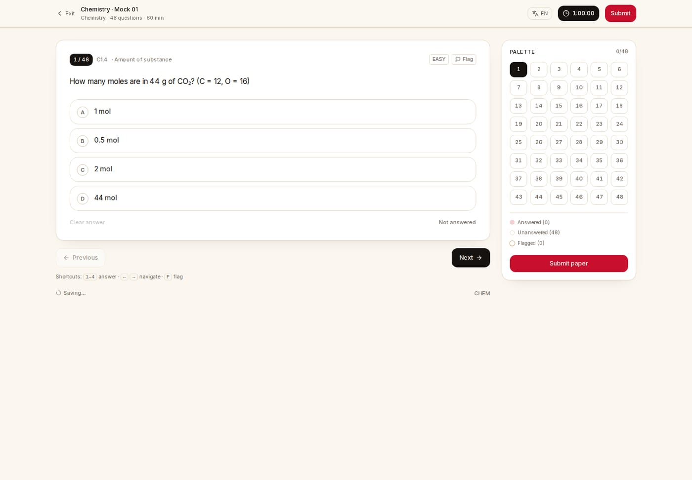
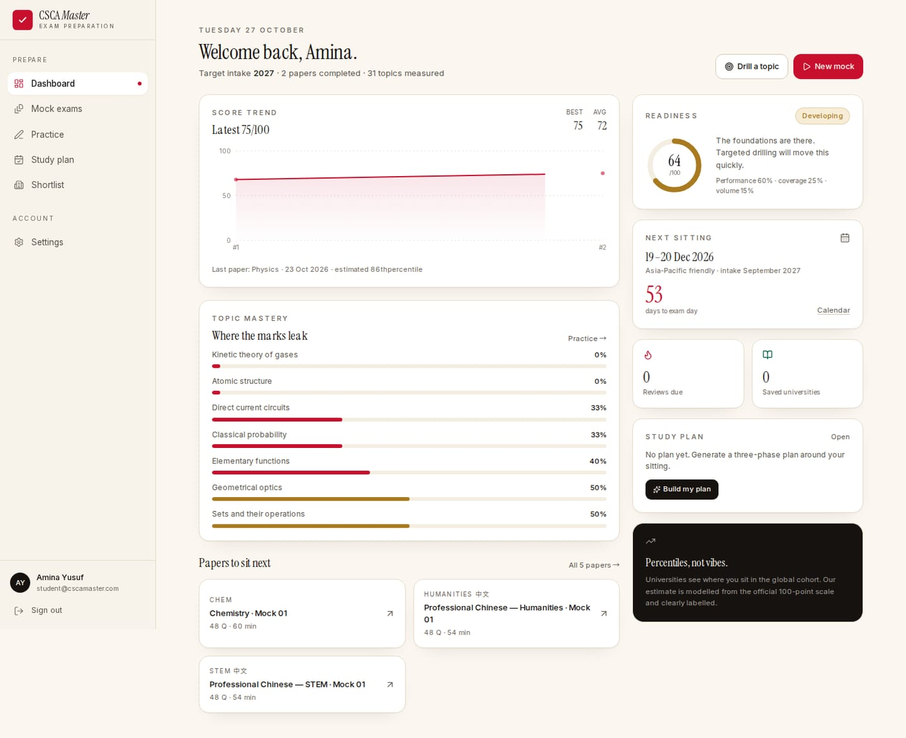

# CSCA Master

**Exam-accurate preparation for the China Scholastic Competency Assessment.**
Production target: **[www.cscamaster.com](https://www.cscamaster.com)** · local: **http://localhost:3002**

CSCA Master is a full preparation platform for international students applying to Chinese
universities. It pairs an exam-fidelity simulator with topic-level analytics, a spaced-review queue, a
bilingual syllabus explorer, scholarship and university-requirements guides, and exam strategy.

The CSCA is administered by the China Scholarship Council. It becomes a required undergraduate
admission document for Chinese Government Scholarship universities in the 2026/27 cycle, and for all
undergraduate applicants from 2028.


| Exam simulator | Result & topic breakdown |
| --- | --- |
|  |  |

| Dashboard | Mock library |
| --- | --- |
|  |  |

---

This repository keeps its verified CSCA research, competitor analysis, exam-fidelity map and
data-authenticity policy in [`CSCA-SKILLS.md`](CSCA-SKILLS.md).

## Quick start

```bash
npm install
cp .env.example .env.local     # already present in this checkout
npm run db:seed                # subjects, syllabus, 2,867 questions, 176 papers, calendar
npm run dev                    # boots the embedded database, then Next.js
```

Open the URL Next prints — **http://localhost:3000** by default. To use another port:
`npm run dev -- -p 3002`.

There is **no database to install.** `npm run dev` starts a Postgres-compatible engine (PGlite) on
`127.0.0.1:55432`, persists it to `.pglite/`, and points Prisma at it. Every query is real SQL, so
production behaves the same on managed Postgres.

### Demo accounts

| Role | Email | Password |
| --- | --- | --- |
| Student | `student@cscamaster.com` | `password123` |
| Admin | `admin@cscamaster.com` | `password123` |

The student account is seeded with two completed papers so the dashboard has history.

Sign-up is self-serve: the visitor verifies a 6-digit email code and the account is created
approved, then signed in automatically. The `status` column still enforces a hold — `requireUser()`
sends a `PENDING`/`REJECTED` account to `/pending` on its next request, so pausing an account is a
single column change, not a UI feature. `/admin/students` is a read-only directory.

---

## What is built

### Marketing, content & SEO

- `/` — conversion landing page with a live countdown to the next sitting
- `/csca` — long-form exam guide (format, subjects, fees, scoring, exemptions, registration)
- `/exam-dates` — published 2026–27 sittings, timetable in Beijing time, regional suitability
- `/syllabus` + `/syllabus/[subject]` — official topic tree with weights and drill links
- `/scholarships` — CGS, provincial, city and university funding
- `/requirements` — which CSCA subjects each programme group needs
- `/tips` — time budget, flag-and-skip, per-subject techniques, error-log method
- `/test-day` — the official home-based test rules: Windows-only client, dual-device proctoring,
  20 Mbps symmetric network, scratch-tool policy, check-in timeline, violation tiers and score release
- `/sample-questions` — free sample questions, no account required (top-of-funnel SEO asset)
- `/tools/score-calculator` — score and percentile estimator
- `/glossary` — CSCA terminology, linkable definitions
- `/guides` + five long-form guides (CSCA vs HSK, 8-week plan, subjects by major, registration, scoring)
- `/pricing`, `/about`, `/contact` — waitlist capture, methodology, lead form
- `/app/official` — official past papers with subject/year filters, answer key, bilingual analysis and timed-mock links
- `/app/reviews` — caveated module review sets with reconstructed keys, kept separate from official papers
- `/admin` — operations overview with student, paper, bank and lead counts
- `/admin/leads` — professional lead CRM: search/filter, priority triage, pipeline status, tags, owner & notes, CSV export
- Static-first output, canonical URLs, OpenGraph image, `sitemap.xml`, `robots.txt`, `llms.txt`
- JSON-LD: Organisation, WebSite, Course, FAQPage, Article, BreadcrumbList, DefinedTermSet

### Exam simulator

- **Test Client simulation** on `/exam/[slug]`: pre-test system check (real network / viewport /
  full-screen / microphone-permission checks), the Integrity Commitment Form, language choice,
  official vs practice conditions, a 3‑2‑1 countdown, and a ticket strip
- Official-client layout: question palette on the **left** with answered numbers in green, amber
  flags, ringed current question, autosave indicator, full-screen request on start
- **Official mode** disables early submission (the paper submits itself at 00:00) and warns on
  focus loss the way a proctor would; **practice mode** keeps early exit for drills
- Official structure on every paper: 48 questions / 60 minutes for Maths, Physics and Chemistry,
  80 questions / 90 minutes for both Professional Chinese papers — the same length, ordering and
  0–100 scale as the real sitting
- Server-anchored timer (a refresh cannot buy minutes), auto-submit at zero
- Question palette, flags, answered/unanswered states, keyboard shortcuts (`1–4`, `←/→`, `F`)
- Autosave every ~1s to the server; resume on any device with the clock still running
- EN/中文 toggle for fundamental subjects
- LaTeX rendered through KaTeX
- Scoring on the server only: raw correct → 0–100, per-topic breakdown, modelled percentile

### Analytics & study

- Dashboard: readiness score, score trend, topic mastery, next sitting countdown, review queue
- Result review: every question, your answer, the correct answer and the working — collapsed by
  default so a 48-question review is navigable
- Practice: 60 topics (all six official Professional Chinese item types included), a 2,800+ question bank, difficulty filters, 10-question "quick drills", instant explanations, attempt tracking
- Smart review: spaced-repetition ladder (1 → 3 → 6 → 12 → 21 days)
- Study plan: three phases dated backwards from the target sitting, with a persisted checklist

### Admin

- `/admin` — students, submissions, average score, bank coverage
- `/admin/students` — student directory (search, profile, per-student attempt history)
- `/admin/content` — curriculum and paper inventory
- `/admin/leads` — waitlist and contact enquiries

---

## Search-engine setup (once per deployment)

1. **Verify ownership.** Get the token from Search Console → *Add property* → *HTML tag* → the
   `content="…"` value, then put it in `/docker/csca-prep/.env` as:

   ```
   GOOGLE_VERIFICATION=the-content-value
   ```

   and rebuild (`bash deploy/deploy.sh`). **A rebuild, not a restart**: Next bakes metadata for the
   static routes at build time, so the token has to be a build arg (`Dockerfile` → `ARG`, compose →
   `build.args`). Empty values are omitted entirely, so an unconfigured deployment publishes nothing.

   The same three keys exist for Bing (`BING_VERIFICATION`) and Yandex (`YANDEX_VERIFICATION`).
   The DNS route also works and needs no rebuild: add a `TXT` record `google-site-verification=…` on
   `@` in the Cloudflare zone.
2. **Submit the sitemap** at `https://<domain>/sitemap.xml` in Search Console and Bing Webmaster Tools.
   It is served by `src/app/sitemap.xml/route.ts` with a **5-minute edge TTL** — a metadata-route
   sitemap inherits a 24-hour `s-maxage`, which hides every page added in the last deploy. `deploy.sh`
   purges and re-checks the live URL count at the end of every deploy.
   `lastModified` comes from `src/lib/content-dates.ts` — bump `CONTENT_UPDATED` when you change facts.
3. **Ping IndexNow after a content deploy**: `npm run seo:indexnow`. The key file is served at
   `/csca-master-2026.txt`, so there is nothing to configure.
4. **Log the change** in `UPDATES` (`src/lib/content-dates.ts`) — the public changelog at `/csca/updates`
   and the sitemap date then agree.

## Stack

| Layer | Choice |
| --- | --- |
| Framework | Next.js 16 (App Router, Server Components, Server Actions) |
| UI | React 19, Tailwind CSS v4, Radix primitives, Lucide icons |
| Data | Prisma 7 + PostgreSQL (PGlite locally, managed Postgres in production) |
| Auth | Email + password (bcrypt), JWT in an httpOnly cookie (`jose`) |
| Charts | Recharts for the score trend; CSS for everything else |
| Maths | KaTeX (server-rendered HTML) |

No external auth vendor, no UI kit at runtime, no third-party analytics.

---

## Two monolingual teaching sections

The product is split by the language a degree is taught in, and each section is
monolingual end to end:

| | English-taught | Chinese-taught |
| --- | --- | --- |
| Section root | `/app/english` | `/app/chinese` |
| Subjects | Mathematics, Physics, Chemistry | 文科中文, 理科中文, 数学, 物理, 化学 |
| Paper/question language | English only | 中文 only |
| Professional Chinese | Not required, never shown | Compulsory |

How the boundary is enforced:

- `src/lib/tracks.ts` is the single source of truth for the two tracks:
  subjects, defaults, labels, per-track Prisma filters and section links.
- `src/lib/i18n.ts` carries the Chinese app copy. The section language comes
  from the current section, so the sidebar, buttons, dialogs and empty states
  switch with it.
- `src/proxy.ts` resolves the section from `?taught=EN|ZH` or the section root,
  forwards it to the layout as `x-csca-track` and persists it in `csca_taught`.
  `getSectionTrack()` / `getResolvedTrack()` in `src/lib/section.ts` read it.
- Practice and the daily quiz filter questions with `trackQuestionWhere()`.
  English-only legacy drill items never appear in the Chinese section;
  fundamental items without Chinese text are excluded there.
- Mocks and official papers use `trackPaperWhere()`: a Chinese-taught paper must
  have Chinese text on every item, so English-only review modules are excluded.
  Fundamental practice sets are assembled from bilingual items only.
- Exam attempts store the section they were started from (`Attempt.track`), so
  results and dashboard history do not cross sections.
- Papers carry `titleZh` / `subtitleZh`, so the Chinese section shows
  “数学 · 官方真题 · 2026年3月” rather than the English title.

The sidebar only lists the current section; the EN / 中文 switch moves between
them, and `/app/settings` stores the default. The marketing site keeps its
existing `/zh/...` pages as the public Chinese entry points.

## Content pipeline

All curriculum content lives in version-controlled TypeScript, not in an admin form:

```
prisma/seed-data/
  syllabus.ts                      # 5 subjects + 60 topics, bilingual, with weights
  legacy.ts                        # loader for the bulk drill bank (prisma/seeds/*.json)
  questions/math.ts                # 56 curated items (used in mocks)
  questions/physics.ts             # 56
  questions/chemistry.ts           # 56
  questions/chinese-humanities.ts  # 52 + 36 in -extra (识解汉字 / 辨析词语 / 补全语句)
  questions/chinese-stem.ts        # 52 + 54 in -extra (识解汉字 / 辨析词语 / 补全语句)
  questions/official-math.ts       # 48 official March 2026 Mathematics questions
  questions/official-math-apr-2026.ts # 48 official April 2026 Mathematics questions
  questions/official-math-jun-2026.ts # 48 official June 2026 Mathematics questions
  questions/official-math-jan-2026.ts # 47 official January 2026 Mathematics questions (Q48 table unavailable)
  questions/official-math-dec-2025.ts # 48 official December 2025 Mathematics questions
  questions/official-chemistry.ts  # 48 official January 2026 Chemistry questions
  questions/official-chemistry-mar-2026.ts # 48 official March 2026 Chemistry questions
  questions/official-chemistry-apr-review.ts # 20 official April 2026 Chemistry sprint-review questions
  questions/official-chemistry-dec-2025.ts # 41 official December 2025 Chemistry questions
  questions/official-chinese-humanities-dec-2025.ts # 40 official December 2025 Humanities Chinese language items
  questions/official-math-oct-2025-part1.ts # 45 official October 2025 Mathematics questions (reconstructed key)
  questions/review-math-apr-2026-m1.ts # 15 verified April 2026 Math review-module questions
  questions/review-math-apr-2026-m2.ts # 19 verified April 2026 Math Functions review questions
  questions/review-math-apr-2026-m3.ts # 20 verified April 2026 Math Geometry & Algebra review questions
  questions/review-math-apr-2026-m4.ts # 20 verified April 2026 Math Probability & Statistics review questions
  questions/review-physics-apr-2026-m1.ts # 17 verified April 2026 Physics Mechanics review questions
  questions/review-physics-apr-2026-m2.ts # 19 verified April 2026 Physics Electromagnetism review questions
  questions/official-physics.ts    # 48 official January 2026 Physics questions
  questions/official-physics-mar-2026.ts # 48 official March 2026 Physics questions
  questions/official-physics-apr-2026.ts # 48 official April 2026 Physics questions
  questions/official-physics-dec-2025.ts # 41 official December 2025 Physics questions (5 figure items omitted)
prisma/seeds/*.json                # ~2,000 legacy drill questions (practice only)
```

`npm run db:seed` is idempotent: stable IDs mean you can edit a question and re-seed without losing
attempt history. Mock papers are rebuilt from the bank on each seed.

Question shape:

```ts
{
  topic: "M2.4",                 // syllabus topic code, required
  difficulty: "MEDIUM",          // EASY | MEDIUM | HARD
  stem: "Differentiate $f(x)=3x^{4}-2x$.",
  stemZh: "求 $f(x)=3x^{4}-2x$ 的导数。",
  options: ["12x³ − 2", …],      // exactly 4
  optionsZh: ["12x³ − 2", …],
  correct: 0,
  explanation: "Power rule …",
  explanationZh: "由幂函数求导法则 …",
  tags: ["derivatives"]
}
```

---

## Exam reference (verified 13 November 2026)

| Paper | Questions | Time | Language | Score |
| --- | --- | --- | --- | --- |
| Professional Chinese — Humanities | 80 | 90 min | Chinese | 0–100 |
| Professional Chinese — STEM | 80 | 90 min | Chinese | 0–100 |
| Mathematics | 48 | 60 min | Chinese / English | 0–100 |
| Physics | 48 | 60 min | Chinese / English | 0–100 |
| Chemistry | 48 | 60 min | Chinese / English | 0–100 |

Fees: CNY 450 for one subject, CNY 700 for two or more. Six sittings a year (Jan, Mar, Apr, Jun, Nov,
Dec), each over two days: day one is Professional Chinese then Mathematics, day two Physics then
Chemistry, Beijing time. **Start times alternate between an 08:00 and a 14:00 block by sitting** — the
official notice for the 2026–27 calendar says so, and the structured calendar lives in
`research/normalized/csca/exam-calendar.json`. Results within 10 working days. Registration only at
[csca.cn](https://csca.cn).

---

## Agent skills and research

`.agents/skills/` carries the project skills an agent should load before working here:

| Skill | Load it for |
| --- | --- |
| `csca-official` | Any fact about the real CSCA — papers, dates, fees, rules, scoring, delivery modes |
| `csca-competitors` | Positioning, pricing, comparison pages, content gaps, outreach |
| `csca-prep-project` | Any code change: stack, routes, tracks, content pipeline, design system, conventions |

`research/` is the evidence behind them, gathered through the **api-anything** plugin from `csca.cn`,
the China Admissions guidebook and six competitor sites. See `research/README.md` for provenance,
refresh commands and the compliance note.

---

## Deployment

1. Create a managed Postgres database (Neon, Supabase, RDS).
2. Set environment variables on Vercel:

   ```
   DATABASE_URL=postgresql://…
   JWT_SECRET=<32+ random bytes>
   NEXT_PUBLIC_APP_URL=https://www.cscamaster.com
   ```

3. Point `cscamaster.com` and `www` at Vercel, then run the schema push and seed once:

   ```bash
   npx prisma db push
   npm run db:seed
   ```

4. Submit `https://www.cscamaster.com/sitemap.xml` in Google Search Console.

`postinstall` runs `prisma generate`, so the build works from a clean checkout.

### Production notes (Hostinger VPS)

The app runs on a KVM-2 VPS behind Traefik, with Cloudflare in front — see
`deploy/README.md` for the full runbook.

- **The edge cache matters.** Next prerenders the marketing pages, but
  Cloudflare does not cache HTML by default, so every request used to reach
  the single `next start` process on the VPS (TTFB 1.3–12.4 s). A Cache Rule
  now puts the marketing pages in Cloudflare's edge cache; `deploy/deploy.sh`
  applies it on every deploy, **purges the edge afterwards** (otherwise
  visitors stay on the previous build), and `deploy/verify.sh` fails if the
  rule is missing. Check it with `bash deploy/cache-check.sh`.
- **One Node process is enough.** Measured on the VPS: 200 concurrent requests
  at p95 201 ms with 0.02 % CPU, and a sustained 50 req/s with zero errors.
  Workers were deliberately *not* added — see `deploy/README.md` for the
  numbers, and re-run `deploy/loadtest.sh` if they ever change.
- **Logged-in traffic is still origin-bound.** The cache rule only covers the
  public marketing pages. `/app/*`, `/exam/*` and `/api/*` are per-session and
  must never be cached — which means students still hit the VPS directly.
  If that latency becomes noticeable, run several Node workers behind the
  single container or move the dynamic half to a bigger host.
- **Fonts are vendored** in `src/fonts/` and loaded with `next/font/local`, so
  the Docker build never depends on reaching Google Fonts.
- **`JWT_SECRET` must be 32+ characters** and the app refuses to start with
  the example value from `.env.example`.

---

## SEO strategy (the short version)

1. **Own the entity, not just the keyword.** Every page names *China Scholastic Competency
   Assessment*, links to the official source and uses consistent facts, so search engines can treat
   this site as a canonical reference.
2. **Long-tail capture.** Syllabus topic pages, guides, the requirements page, scholarships page and
   the glossary answer specific queries ("CSCA maths syllabus", "CSCA subject requirements",
   "Chinese Government Scholarship", "CSCA vs HSK").
3. **Free tools as link magnets.** Sample questions and the score calculator give people a reason to
   link without paying.
4. **Technical hygiene.** Static/ISR marketing pages, one H1 per page, canonical URLs, breadcrumb
   schema, sitemap with last-modified, `llms.txt` for AI assistants.
5. **Depth over volume.** Five substantial guides beat fifty thin posts. Add a guide only when it can
   be the best answer to a real question.

---

## Security notes

- **Passwords**: bcrypt (cost 11). `JWT_SECRET` must be 32+ characters and the
  app refuses to start with the example value from `.env.example` — anyone who
  copies it can forge an admin session.
- **Sessions**: JWT in an httpOnly cookie, 30 days. A `tokenVersion` column is
  embedded in the token, so a password change invalidates every session
  issued before it.
- **Rate limiting**: sign-in (per account *and* per address), OTP request and
  verification, the public lead form and the practice endpoint are throttled
  in Postgres, so a restart does not reset the allowance.
- **No account enumeration**: sign-in and password reset return the same
  response whether or not the address exists, and the password comparison
  always runs bcrypt so the timing is constant.
- **Admin routes** are guarded at the routing layer by `src/middleware.ts`, so
  an anonymous request never reaches a page that could render student data
  into a redirect body.
- **Exam timing** is enforced by the server: answers are refused after the
  deadline, and a late submit scores only what was persisted before it.

## Known limitations (deliberate, documented)

- **Chinese papers are short papers** (48 items, 54 minutes) rather than the official 80/90. The card
  and footer say so.
- **Concept lessons are English-only.** The Chinese-taught section therefore
  links to practice, mocks and official papers, not to `/app/learn`; the lesson
  body has not been translated yet.
- **Some transcribed/Review papers are English-only** (the April 2026 Math and
  Physics review modules, the October 2025 part 2 items). They stay in the
  English section; the Chinese section only lists papers with Chinese text on
  every item.
- **One fully original paper per subject.** The `Paper 01` mocks (one per subject) use only
  questions written from scratch. The 150 practice sets (30 per subject) assemble a mix of
  official, review and original items from the bank; the Official and Review archives are
  transcribed and labelled as such.
- **Percentiles are modelled**, not official cohort data. Labelled as estimates everywhere.
- **Requirements and scholarships are guidance, not policy.** They reflect the official CSCA
  structure and published funding rates; universities change rules and amounts each cycle.
- **Email verification is an OTP check, not a domain check.** Sign-up and password reset both send a
  6-digit code through Resend. There is no OAuth provider and no admin approval gate — accounts are
  approved on sign-up.
- **No payment integration.** Pro is sold by coupon code (see `Coupon` / `Redemption` in the schema),
  not a checkout.
- **Six sittings a year**, not five: January, March, April, June, November and December. The
  `EXAM_SITTINGS` data had six entries while the copy said five — the copy was wrong.
- The legacy drill bank is bulk/templated content. It appears in topic drills and in a small slice of
  the practice sets; the scored `Paper 01` mocks and every official/review paper use the curated bank
  only.

---

## Scripts

| Command | Purpose |
| --- | --- |
| `npm run dev` | Start embedded Postgres + Next.js dev server |
| `npm run db` | Start the embedded database only |
| `npm run db:seed` | Seed/refresh content (idempotent) |
| `npm run db:reset` | Drop, recreate and reseed the database |
| `npm run build` | Production build |
| `npm run start` | Serve the production build |
| `npm run lint` | ESLint |

---

## Positioning note

CSCA Master is **independent**. It is not affiliated with the China Scholarship Council or CSCA, and it
does not sell registrations or score reports.

**We share the official past papers.** The real sittings — the questions, the published answer keys
and the working — are transcribed and published free, attributed to the source. On top of that the
bank carries 1,938 templated drill items and **322 questions written from scratch** against the
published syllabus. Reconstructed review modules are labelled separately so they are never mistaken
for an official paper. Format facts are transcribed from official CSC notices with sources linked.

Official papers are read-only for Free accounts — study them with the working revealed — and can be
sat on the clock with Pro.
